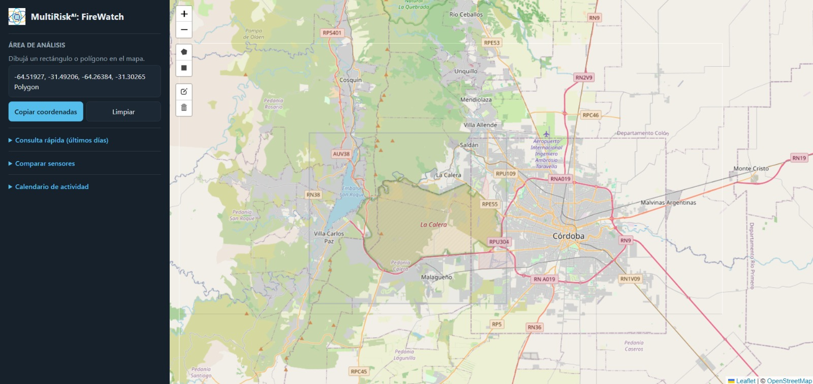
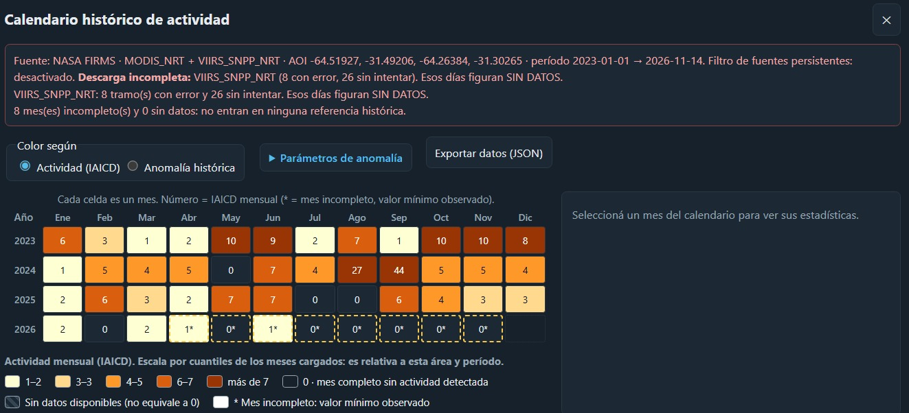
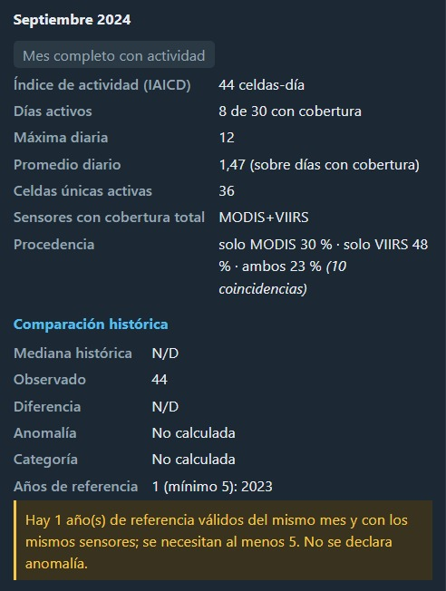

> [!NOTE]
> This is the English version of the FireWatch README.

<a id="english-version"></a>

# FireWatch

## Wildfire monitoring, satellite data harmonization, and temporal pattern analysis.

**Try the project:** https://mr-firewatch.vercel.app/

[](https://www.spaceappschallenge.org/)


FireWatch is a web application for wildfire monitoring and analysis that uses satellite data from NASA FIRMS (Fire Information for Resource Management System) to identify, visualize, compare, and analyze historical fire activity across different geographic regions.

## Table of Contents

- [The Problem](#the-problem)
- [The Solution](#the-solution)
- [How It Works](#how-it-works)
- [How the 1 km Grid Works](#how-the-1-km-grid-works)
- [How We Built It](#how-we-built-it-48-hour-development)
- [Technologies and Tools](#technologies-and-tools)
- [Data Sources](#data-sources-and-acknowledgments)
- [Spanish Version](#spanish-version)

---

## The Problem

Wildfires are a major environmental challenge. Understanding their behavior requires analyzing not only where they occur, but also how they evolve over time and how they are geographically distributed, identifying historical patterns to improve future decision-making.

NASA FIRMS provides information from different satellite instruments, including MODIS and VIIRS. However, these sensors have different spatial resolutions, observation characteristics, and numbers of detections.

This creates several challenges:

- **Sensor differences:** MODIS and VIIRS may record different numbers of detections over the same region.
- **Comparison difficulties:** Directly comparing their records can lead to inconsistent interpretations.
- **Temporal fragmentation:** Analyzing individual detections makes it difficult to identify activity patterns over extended periods.
- **Geographic interpretation:** Large volumes of records require tools that make it easier to identify concentrations and recurring patterns.

Historical records must be transformed into organized and comparable information to better understand wildfire activity.

## The Solution

FireWatch integrates and harmonizes MODIS and VIIRS records to provide a more comprehensive view of thermal activity within a region.

Its functionality combines five main capabilities:

1. **Geographic monitoring:** Visualization of satellite detections on an interactive map.
2. **Data integration:** Retrieval of records from MODIS and VIIRS sensors.
3. **Spatial harmonization:** Organization of detections into a common geographic structure.
4. **Comparative analysis:** Identification of overlaps, differences, and statistical indicators between sensors.
5. **Temporal analysis:** Study of activity over time and identification of patterns across selected periods.

FireWatch is more than a hotspot visualizer: it is an analytical tool. Active cell-days are compared on a common grid, "no data" is distinguished from "no activity," and every result is accompanied by controls indicating how reliable it is.

FireWatch aims to take advantage of MODIS and VIIRS records together, while making their limitations transparent.

## How It Works

The application allows users to select a geographic region and retrieve satellite-recorded activity. Based on that selection, the data is processed and presented through maps, comparisons, and historical calendars.

### 1. Region Selection

Users draw a rectangle or polygon on the map to define the area they want to study.



### 2. Satellite Data Retrieval

Users select the sensors, dates, and query parameters. FireWatch retrieves the corresponding records from NASA FIRMS.

### 3. Sensor Comparison

MODIS and VIIRS records are organized into a common 1 km geographic grid, making it possible to identify overlaps and differences between both sensors.

### 4. Results Visualization

Overlaps and differences are represented on the map using colors:

- Green: Detection shared by both sensors.
- Orange: Detection exclusive to sensor A.
- Blue: Detection exclusive to sensor B.

### 5. Analysis Validation

FireWatch allows users to verify how results change when modifying cell size and to perform statistical checks to evaluate the observed overlaps.


### 6. Historical Calendar

The application generates a calendar showing recorded activity over an extended period. It allows users to identify periods of increased activity, consult statistics, and detect anomalies compared to previous years.



## How the 1 km Grid Works

One of FireWatch's main contributions is organizing detections from different satellite instruments into a common geographic structure.

MODIS has an approximate spatial resolution of 1 km, while VIIRS has a finer resolution of approximately 375 m. Comparing their original detections directly can produce misleading results because a single fire may generate multiple VIIRS detections within an area covered by a MODIS pixel.

FireWatch addresses this issue through spatial aggregation:

1. Each detection retains its original geographic coordinates and observation date.
2. The geographic coordinates are converted into approximate distances in kilometers.
3. A common grid is generated using a configurable cell size, set to 1 km by default.
4. Each detection is assigned to a cell using its calculated grid indices.
5. Detections sharing the same cell and date are grouped into a single active cell-day.
6. Both sensors are processed using the same reference latitude, grid size, and cell boundaries.

The grid uses the following approximate conversion:

- Latitude: 1 degree ≈ 110.574 km.
- Longitude: 1 degree ≈ 111.320 × cos(reference latitude) km.

The reference latitude corresponds to the center of the selected area.

Cell indices are calculated using the floor function:

```javascript
cellX = Math.floor((longitude * kmPerDegreeLng) / cellSizeKm);
cellY = Math.floor((latitude * kmPerDegreeLat) / cellSizeKm);
```

This creates a consistent spatial framework in which both sensors can be compared using the same geographic cells.

**Important:** This is a local geographic approximation, not a UTM projection. Its accuracy depends on the size and location of the selected area.

An active cell-day means that at least one detection was recorded within a particular cell on a particular day. It does not represent an individual fire event or the total burned area.

## How We Built It (48-Hour Development)

Development was organized into five work blocks, each focused on a different part of FireWatch's functionality.

### Block 1 — Map and Data Acquisition

Creation of the application, configuration of the interactive map, and connection to NASA FIRMS to retrieve satellite detections.

**Files:**

- `index.html`
- `style.css`
- `script.js`
- `config.js`
- `api/getFirmsData.js`

### Block 2 — Harmonization and Comparison

Development of the system that organizes MODIS and VIIRS records into a common grid, identifies overlaps, and calculates comparison indicators.

**Files:**

- `harmonize.js`
- `script.js`

### Block 3 — Historical Analysis

Implementation of the IAICD indicator (active cell-days), processing of daily, monthly, and yearly records, and detection of historical anomalies.

**Files:**

- `activity.js`
- `harmonize.js`


### Block 4 — Results Visualization

Integration of the analyses into the interface, incorporating map data layers, date selectors, charts, statistics, and a historical calendar.

**Files:**

- `script.js`
- `calendar-ui.js`
- `index.html`
- `style.css`



### Block 5 — Validation and Final Integration

Functionality testing, statistical checks, bug fixes, and interface simplification to ensure a clear and reproducible demonstration.

**Files:**

- `harmonize.js`
- `activity.js`
- `script.js`
- `calendar-ui.js`

## Technologies and Tools

- **HTML, CSS, and JavaScript:** Web application development.
- **Leaflet:** Interactive mapping and geographic visualization.
- **NASA FIRMS:** Satellite data source.
- **MODIS and VIIRS:** Instruments used to detect thermal activity.
- **Vercel:** Application hosting and backend execution.
- **Node.js:** Processing of requests to NASA FIRMS.

## Data Sources and Acknowledgments

FireWatch uses publicly available satellite observations provided by NASA's Fire Information for Resource Management System (FIRMS).

### NASA FIRMS Products

The application supports the following active fire data products:

| Instrument | Satellite | FIRMS product identifiers |
|---|---|---|
| MODIS | Terra / Aqua | `MODIS_NRT`, `MODIS_SP` |
| VIIRS | Suomi-NPP | `VIIRS_SNPP_NRT`, `VIIRS_SNPP_SP` |
| VIIRS | NOAA-20 | `VIIRS_NOAA20_NRT`, `VIIRS_NOAA20_SP` |
| VIIRS | NOAA-21 | `VIIRS_NOAA21_NRT`, `VIIRS_NOAA21_SP` |

**NRT (Near Real-Time):** Products providing observations with low latency. They may be revised as additional processing becomes available.

**SP (Standard Processing):** Standard processing products, which provide a more finalized version of satellite observations.

The application retrieves these records through the NASA FIRMS Area API, using a server-side request to protect the API key.

## Results and Methodological Limitations

### Validation Results

In the first validation, conducted over a pilot region for 214 days, the following results were obtained:

- **11 exact matches out of 81 active cell-days in the combined comparison.**
- **Jaccard index:** 13.6%.
- **Dice coefficient with a 3×3 neighborhood tolerance:** 59.8%.
- **Jaccard index using 3 km cells:** 29.3%.
- **Randomness control:** All 102 tests produced overlap values below the observed result.

These results show that spatial resolution and cell size influence the degree of agreement between sensors. The neighborhood-based comparison also identifies detections that fall into nearby cells rather than exactly the same cell.

### Methodological Limitations

FireWatch makes the limitations of satellite observations and its own processing methodology explicit.

**1. Different spatial resolutions**

MODIS has an approximate spatial resolution of 1 km, while VIIRS has an approximate resolution of 375 m. VIIRS can detect smaller or cooler thermal anomalies that MODIS may not identify. Therefore, their raw detection counts are not directly equivalent.

**2. Different observation characteristics**

Satellites have different overpass times, observation geometries, and coverage patterns. A fire may be detected by one instrument but not another because of these differences.

**3. Geographic grid approximation**

The common grid uses an approximate conversion from geographic coordinates to kilometers, based on a reference latitude. It is not a projected coordinate system such as UTM. Errors may increase when analyzing larger geographic areas.

**4. Cell boundary effects**

Two detections that are geographically close may fall on opposite sides of a grid boundary. In an exact comparison, they will be classified as separate detections even if they represent nearby thermal activity.

The 3×3 neighborhood comparison helps identify these spatially close observations.

**5. Daily temporal resolution**

The comparison uses observation dates rather than exact satellite overpass times. Consequently, it does not establish that both sensors observed the same fire at precisely the same moment.

**6. Thermal anomalies versus confirmed wildfires**

NASA FIRMS records active fire and thermal anomalies. Not every detection necessarily represents a confirmed wildfire. Industrial heat sources, other persistent heat sources, and non-wildfire thermal events may also appear in satellite records.

**7. Data availability and processing differences**

Near-real-time and standard products may differ in availability and processing status. Missing observations must not automatically be interpreted as days without fire activity.

**8. Statistical interpretation**

The validation results describe agreement within a specific pilot region and observation period. They should not be interpreted as universal performance measurements for all geographic regions or satellite conditions.

The 102 randomness-control tests provide additional context for the observed overlap, but do not independently establish that the sensors measure identical fire events.

FireWatch is an analytical and monitoring tool. Its results are intended to support the interpretation of satellite observations, not replace official emergency information or ground-based verification.

## Final Statement

**FireWatch — Transforming satellite data into information to understand wildfire activity.**

---

<a id="spanish-version"></a>

> [!NOTE]
> This is the Spanish version of the FireWatch README.

# FireWatch

## Monitoreo de incendios forestales, armonización de datos satelitales y análisis de patrones temporales.

**Prueba el proyecto:** https://mr-firewatch.vercel.app/

[](https://www.spaceappschallenge.org/)


FireWatch es una aplicación web de monitoreo y análisis de incendios forestales que utiliza datos satelitales de NASA FIRMS (Fire Information for Resource Management System) para identificar, visualizar, comparar y analizar la actividad histórica de incendios en distintas regiones geográficas.

## Índice

- [El problema](#el-problema-1)
- [La solución](#la-solución)
- [Cómo funciona](#cómo-funciona)
- [Cómo funciona la grilla de 1 km](#cómo-funciona-la-grilla-de-1-km)
- [Cómo lo hicimos](#cómo-lo-hicimos-desarrollo-en-48-hs)
- [Tecnologías y herramientas](#tecnologías-y-herramientas-1)
- [Fuentes de datos](#fuentes-de-datos-y-agradecimientos)
- [English Version](#english-version)

---

## El problema

Los incendios forestales son una problemática ambiental. Comprender su comportamiento requiere analizar no solamente dónde se producen, sino también cómo evolucionan a lo largo del tiempo y cómo se distribuyen geográficamente, identificando patrones históricos para mejorar el accionar a futuro.

NASA FIRMS proporciona información de diferentes instrumentos satelitales, entre ellos MODIS y VIIRS. Sin embargo, estos sensores poseen distintas resoluciones espaciales, características de observación y cantidades de detecciones.

Esto presenta algunos desafíos:

- **Diferencias entre sensores:** MODIS y VIIRS pueden registrar distintas cantidades de detecciones sobre una misma región.
- **Dificultad de comparación:** comparar directamente sus registros puede generar interpretaciones inconsistentes.
- **Fragmentación temporal:** observar detecciones individuales dificulta reconocer patrones de actividad a lo largo de períodos extensos.
- **Interpretación geográfica:** grandes volúmenes de registros requieren herramientas que permitan identificar concentraciones y recurrencias.

Es necesario transformar estos registros históricos en información organizada y comparable para poder comprender la actividad de los incendios.

## La solución

FireWatch integra y armoniza los registros de MODIS y VIIRS para ofrecer una visión más completa de la actividad térmica en una región.

Su funcionamiento combina cinco capacidades principales:

1. **Monitoreo geográfico:** visualización de detecciones satelitales sobre un mapa interactivo.
2. **Integración de datos:** consulta de registros de los sensores MODIS y VIIRS.
3. **Armonización espacial:** organización de las detecciones en una estructura geográfica común.
4. **Análisis comparativo:** identificación de coincidencias, diferencias e indicadores estadísticos entre sensores.
5. **Análisis temporal:** estudio de la evolución de la actividad y reconocimiento de patrones durante períodos determinados.

FireWatch no es solo un visualizador de focos, es una herramienta de análisis. Se comparan celdas-día activas sobre una grilla común, se separa "sin datos" de "sin actividad", y cada resultado se acompaña de controles que indican cuánto se puede confiar en él.

FireWatch busca aprovechar los registros MODIS y VIIRS conjuntamente, con sus limitaciones a la vista.

## Cómo funciona

La aplicación permite seleccionar una región geográfica y consultar la actividad registrada por los satélites. A partir de esa selección, los datos se procesan y se presentan mediante mapas, comparaciones y calendarios históricos.

### 1. Selección de una región

El usuario dibuja un rectángulo o polígono sobre el mapa para delimitar el área que desea estudiar.


### 2. Consulta de datos satelitales

Se seleccionan los sensores, las fechas y los parámetros de consulta. FireWatch obtiene los registros correspondientes desde NASA FIRMS.

### 3. Comparación de sensores

Los registros de MODIS y VIIRS se organizan en una grilla geográfica común de 1 km, permitiendo identificar las coincidencias y diferencias entre ambos.

### 4. Visualización de resultados

Las coincidencias y diferencias se representan sobre el mapa mediante colores:

- Verde: coincidencia entre ambos sensores.
- Naranja: detección exclusiva del sensor A.
- Azul: detección exclusiva del sensor B.

### 5. Validación del análisis

FireWatch permite comprobar cómo cambian los resultados al modificar el tamaño de las celdas y realizar controles estadísticos para evaluar las coincidencias observadas.


### 6. Calendario histórico

La aplicación genera un calendario con la actividad registrada durante un período extenso. Permite identificar períodos de mayor actividad, consultar estadísticas y detectar anomalías respecto de años anteriores.


## Cómo funciona la grilla de 1 km

Uno de los principales aportes de FireWatch es organizar las detecciones de distintos instrumentos satelitales en una estructura geográfica común.

MODIS tiene una resolución espacial aproximada de 1 km, mientras que VIIRS posee una resolución más fina, de aproximadamente 375 m. Comparar directamente sus detecciones originales puede generar resultados engañosos porque un mismo incendio puede producir múltiples detecciones VIIRS dentro de un área cubierta por un píxel MODIS.

FireWatch aborda este problema mediante una agregación espacial:

1. Cada detección conserva sus coordenadas geográficas originales y su fecha de observación.
2. Las coordenadas geográficas se convierten en distancias aproximadas en kilómetros.
3. Se genera una grilla común con un tamaño de celda configurable, establecido en 1 km por defecto.
4. Cada detección se asigna a una celda mediante sus índices calculados.
5. Las detecciones que comparten una misma celda y fecha se agrupan en una única celda-día activa.
6. Ambos sensores se procesan utilizando la misma latitud de referencia, tamaño de celda y límites geográficos.

La grilla utiliza la siguiente conversión aproximada:

- Latitud: 1 grado ≈ 110,574 km.
- Longitud: 1 grado ≈ 111,320 × cos(latitud de referencia) km.

La latitud de referencia corresponde al centro del área seleccionada.

Los índices de las celdas se calculan utilizando la función `floor`:

```javascript
cellX = Math.floor((longitude * kmPerDegreeLng) / cellSizeKm);
cellY = Math.floor((latitude * kmPerDegreeLat) / cellSizeKm);
```

Esto genera una estructura espacial consistente en la que ambos sensores pueden compararse utilizando las mismas celdas geográficas.

**Importante:** se trata de una aproximación geográfica local, no de una proyección UTM. Su precisión depende del tamaño y la ubicación del área seleccionada.

Una celda-día activa significa que al menos una detección fue registrada dentro de una celda geográfica durante un día determinado. No representa un incendio individual ni la superficie total quemada.

## Cómo lo hicimos (Desarrollo en 48 hs.)

El desarrollo se organizó en cinco bloques de trabajo, cada uno enfocado en una parte del funcionamiento de FireWatch.

### Bloque 1 — Mapa y adquisición de datos

Creación de la aplicación, configuración del mapa interactivo y conexión con NASA FIRMS para obtener las detecciones satelitales.

**Archivos:**

- `index.html`
- `style.css`
- `script.js`
- `config.js`
- `api/getFirmsData.js`

### Bloque 2 — Armonización y comparación

Desarrollo del sistema que permite organizar MODIS y VIIRS en una grilla común, identificar coincidencias y calcular indicadores de comparación.

**Archivos:**

- `harmonize.js`
- `script.js`

### Bloque 3 — Análisis histórico

Incorporación del indicador IAICD (celdas-día con actividad), procesamiento de registros diarios, mensuales y anuales, y detección de anomalías históricas.

**Archivos:**

- `activity.js`
- `harmonize.js`


### Bloque 4 — Visualización de resultados

Integración de los análisis con la interfaz, incorporando capas de información en el mapa, selectores de fechas, gráficos, estadísticas y calendario histórico.

**Archivos:**

- `script.js`
- `calendar-ui.js`
- `index.html`
- `style.css`


### Bloque 5 — Validación y consolidación

Pruebas de funcionamiento, controles estadísticos, corrección de errores y simplificación de la interfaz para lograr una demostración clara y reproducible.

**Archivos:**

- `harmonize.js`
- `activity.js`
- `script.js`
- `calendar-ui.js`

## Tecnologías y herramientas

- **HTML, CSS y JavaScript:** desarrollo de la aplicación web.
- **Leaflet:** mapa interactivo y representación geográfica.
- **NASA FIRMS:** fuente de datos satelitales.
- **MODIS y VIIRS:** instrumentos utilizados para registrar actividad térmica.
- **Vercel:** alojamiento de la aplicación y ejecución del backend.
- **Node.js:** procesamiento de las consultas a NASA FIRMS.

## Fuentes de datos y agradecimientos

FireWatch utiliza observaciones satelitales de acceso público proporcionadas por NASA FIRMS (Fire Information for Resource Management System).

### Productos de NASA FIRMS

La aplicación admite los siguientes productos de datos de incendios activos:

| Instrumento | Satélite | Identificadores de productos FIRMS |
|---|---|---|
| MODIS | Terra / Aqua | `MODIS_NRT`, `MODIS_SP` |
| VIIRS | Suomi-NPP | `VIIRS_SNPP_NRT`, `VIIRS_SNPP_SP` |
| VIIRS | NOAA-20 | `VIIRS_NOAA20_NRT`, `VIIRS_NOAA20_SP` |
| VIIRS | NOAA-21 | `VIIRS_NOAA21_NRT`, `VIIRS_NOAA21_SP` |

**NRT (Near Real-Time):** productos que proporcionan observaciones con baja latencia. Pueden ser revisados a medida que se dispone de nuevos procesamientos.

**SP (Standard Processing):** productos de procesamiento estándar, que proporcionan una versión más consolidada de las observaciones satelitales.

La aplicación obtiene estos registros mediante la API de área de NASA FIRMS, utilizando consultas desde el servidor para proteger la clave de acceso.

## Resultados y limitaciones metodológicas

### Resultados de validación

En la primera validación realizada sobre una región piloto durante 214 días se obtuvieron:

- **11 coincidencias exactas sobre 81 celdas-día activas en la comparación conjunta.**
- **Índice de Jaccard:** 13,6 %.
- **Coeficiente Dice con tolerancia de vecindad 3×3:** 59,8 %.
- **Índice de Jaccard con celdas de 3 km:** 29,3 %.
- **Control de azar:** las 102 pruebas realizadas quedaron por debajo de la coincidencia observada.

Estos resultados muestran que la resolución espacial y el tamaño de las celdas influyen en el grado de coincidencia entre sensores. La comparación con tolerancia de vecindad también permite identificar detecciones ubicadas en celdas cercanas, en lugar de exigir que coincidan exactamente.

### Limitaciones metodológicas

FireWatch hace explícitas las limitaciones de las observaciones satelitales y de su propia metodología de procesamiento.

**1. Diferentes resoluciones espaciales**

MODIS tiene una resolución espacial aproximada de 1 km, mientras que VIIRS tiene una resolución aproximada de 375 m. VIIRS puede detectar anomalías térmicas más pequeñas o menos intensas que MODIS podría no identificar. Por lo tanto, sus cantidades originales de detecciones no son directamente equivalentes.

**2. Diferentes características de observación**

Los satélites poseen distintos horarios de pasada, geometrías de observación y patrones de cobertura. Un incendio puede ser detectado por un instrumento y no por otro debido a estas diferencias.

**3. Aproximación de la grilla geográfica**

La grilla común utiliza una conversión aproximada de coordenadas geográficas a kilómetros, basada en una latitud de referencia. No es un sistema de coordenadas proyectadas como UTM. Los errores pueden aumentar al analizar áreas geográficas más extensas.

**4. Efectos de los límites de las celdas**

Dos detecciones geográficamente cercanas pueden quedar a ambos lados del límite de una celda. En una comparación exacta, se clasificarán como detecciones separadas aunque representen actividad térmica cercana.

La comparación de vecindad 3×3 ayuda a identificar estas observaciones espacialmente próximas.

**5. Resolución temporal diaria**

La comparación utiliza las fechas de observación y no los horarios exactos de pasada de los satélites. Por lo tanto, no permite establecer que ambos sensores hayan observado el mismo incendio exactamente en el mismo momento.

**6. Anomalías térmicas e incendios confirmados**

Los registros de NASA FIRMS representan incendios activos y anomalías térmicas. No todas las detecciones necesariamente corresponden a incendios forestales confirmados. También pueden aparecer fuentes industriales de calor, otras fuentes térmicas persistentes y eventos que no corresponden a incendios forestales.

**7. Disponibilidad de datos y diferencias de procesamiento**

Los productos de tiempo casi real y los productos estándar pueden diferir en disponibilidad y estado de procesamiento. La ausencia de observaciones no debe interpretarse automáticamente como un día sin actividad de incendios.

**8. Interpretación estadística**

Los resultados de validación describen la coincidencia dentro de una región piloto y un período de observación específicos. No deben interpretarse como medidas universales del rendimiento para todas las regiones geográficas o condiciones satelitales.

Las 102 pruebas de control de azar aportan contexto adicional sobre la coincidencia observada, pero no demuestran por sí solas que los sensores estén midiendo los mismos eventos de incendio.

FireWatch es una herramienta de análisis y monitoreo. Sus resultados buscan facilitar la interpretación de observaciones satelitales, no reemplazar la información oficial de emergencias ni la verificación en terreno.

## Cierre

**FireWatch — Transformando datos satelitales en información para comprender la actividad de los incendios forestales.**