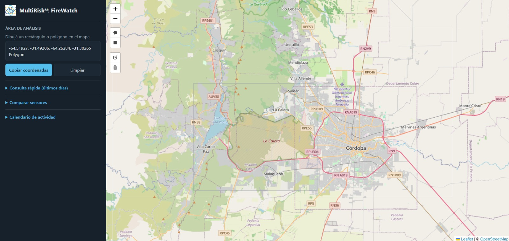
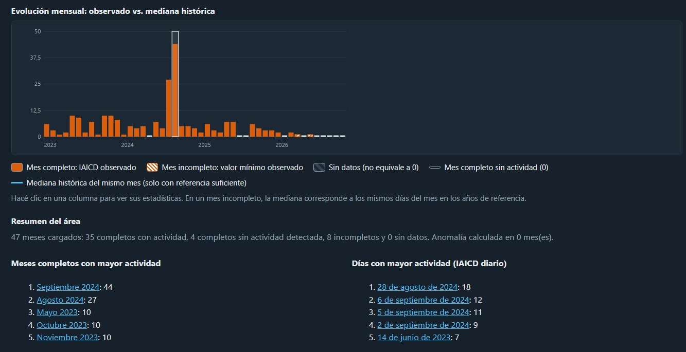
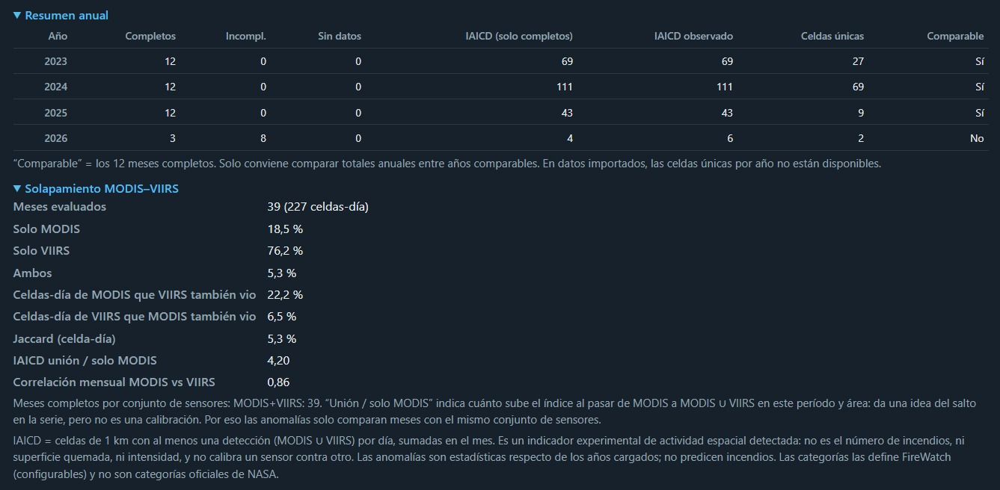
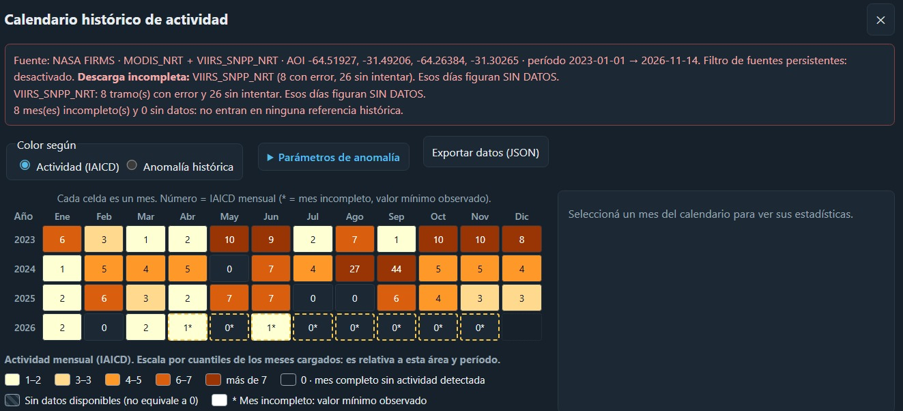
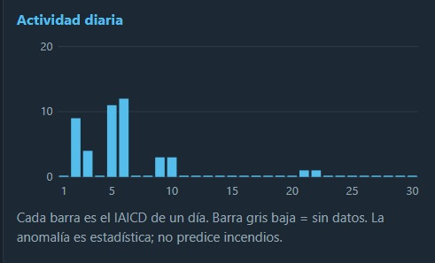
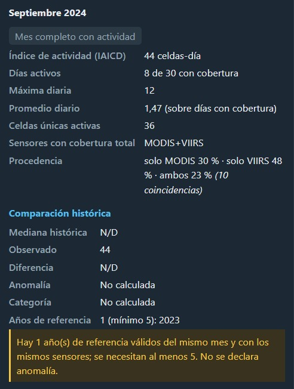

# FireWatch
## Monitoreo de incendios forestales, armonización de datos satelitales y análisis de patrones temporales.

FireWatch es una aplicación web de monitoreo y análisis de incendios forestales que utiliza datos satelitales de NASA FIRMS (Fire Information for Resource Management System) para identificar, visualizar, comparar y analizar la actividad histórica de incendios en distintas regiones geográficas.

## El problema

Los incendios forestales son una problemática ambiental. Comprender su comportamiento requiere analizar no solamente dónde se producen, sino también cómo evolucionan a lo largo del tiempo y cómo se distribuyen geográficamente, identificando patrones históricos para mejorar el accionar a futuro.

NASA FIRMS proporciona información de diferentes instrumentos satelitales, entre ellos MODIS y VIIRS. Sin embargo, estos sensores poseen distintas resoluciones espaciales, características de observación y cantidades de detecciones.

Esto presenta algunos desafíos:

- **Diferencias entre sensores:** MODIS y VIIRS pueden registrar distintas cantidades de detecciones sobre una misma región.
- **Dificultad de comparación:** comparar directamente sus registros puede generar interpretaciones inconsistentes.
- **Fragmentación temporal:** observar detecciones individuales dificulta reconocer patrones de actividad a lo largo de períodos extensos.
- **Interpretación geográfica:** grandes volúmenes de registros requieren herramientas que permitan identificar concentraciones y recurrencias.

Es necesario transformar estos registros históricos en información organizada y comparable para poder comprender la actividad de los incendios.

## La solución

FireWatch integra y armoniza los registros de MODIS y VIIRS para ofrecer una visión más completa de la actividad térmica en una región.

Su funcionamiento combina cinco capacidades principales:

1. **Monitoreo geográfico:** visualización de detecciones satelitales sobre un mapa interactivo.
2. **Integración de datos:** consulta de registros de los sensores MODIS y VIIRS.
3. **Armonización espacial:** organización de las detecciones en una estructura geográfica común.
4. **Análisis comparativo:** identificación de coincidencias, diferencias e indicadores estadísticos entre sensores.
5. **Análisis temporal:** estudio de la evolución de la actividad y reconocimiento de patrones durante períodos determinados.

FireWatch no es solo un visualizador de focos, es una herramienta de análisis. Se comparan celdas-día activas sobre una grilla común, se separa "sin datos" de "sin actividad", y cada resultado se acompaña de controles que indican cuánto se puede confiar en él.

FireWatch busca aprovechar los registros MODIS y VIIRS conjuntamente, con sus limitaciones a la vista.

## Cómo funciona

La aplicación permite seleccionar una región geográfica y consultar la actividad registrada por los satélites. A partir de esa selección, los datos se procesan y se presentan mediante mapas, comparaciones y calendarios históricos.

### 1. Selección de una región

El usuario dibuja un rectángulo o polígono sobre el mapa para delimitar el área que desea estudiar.

### 2. Consulta de datos satelitales

Se seleccionan los sensores, las fechas y los parámetros de consulta. FireWatch obtiene los registros correspondientes desde NASA FIRMS.

### 3. Comparación de sensores

Los registros de MODIS y VIIRS se organizan en una grilla geográfica común de 1 km, permitiendo identificar las coincidencias y diferencias entre ambos.

### 4. Visualización de resultados

Las coincidencias y diferencias se representan sobre el mapa mediante colores:

- Verde: coincidencia entre ambos sensores.
- Naranja: detección exclusiva del sensor A.
- Azul: detección exclusiva del sensor B.

### 5. Validación del análisis

FireWatch permite comprobar cómo cambian los resultados al modificar el tamaño de las celdas y realizar controles estadísticos para evaluar las coincidencias observadas.

### 6. Calendario histórico

La aplicación genera un calendario con la actividad registrada durante un período extenso. Permite identificar períodos de mayor actividad, consultar estadísticas y detectar anomalías respecto de años anteriores.

## Cómo lo hicimos (Desarrollo en 48 hs.)

El desarrollo se organizó en cinco bloques de trabajo, cada uno enfocado en una parte del funcionamiento de FireWatch.

### Bloque 1 — Mapa y adquisición de datos

Creación de la aplicación, configuración del mapa interactivo y conexión con NASA FIRMS para obtener las detecciones satelitales.

**Archivos:**
- `index.html`
- `style.css`
- `script.js`
- `config.js`
- `api/getFirmsData.js`

### Bloque 2 — Armonización y comparación

Desarrollo del sistema que permite organizar MODIS y VIIRS en una grilla común, identificar coincidencias y calcular indicadores de comparación.

**Archivos:**
- `harmonize.js`
- `script.js`

### Bloque 3 — Análisis histórico

Incorporación del indicador IAICD (celdas-día con actividad), procesamiento de registros diarios, mensuales y anuales, y detección de anomalías históricas.

**Archivos:**
- `activity.js`
- `harmonize.js`

### Bloque 4 — Visualización de resultados

Integración de los análisis con la interfaz, incorporando capas de información en el mapa, selectores de fechas, gráficos, estadísticas y calendario histórico.

**Archivos:**
- `script.js`
- `calendar-ui.js`
- `index.html`
- `style.css`

### Bloque 5 — Validación y consolidación

Pruebas de funcionamiento, controles estadísticos, corrección de errores y simplificación de la interfaz para lograr una demostración clara y reproducible.

**Archivos:**
- `harmonize.js`
- `activity.js`
- `script.js`
- `calendar-ui.js`

## Tecnologías y herramientas

- **HTML, CSS y JavaScript:** desarrollo de la aplicación web.
- **Leaflet:** mapa interactivo y representación geográfica.
- **NASA FIRMS:** fuente de datos satelitales.
- **MODIS y VIIRS:** instrumentos utilizados para registrar actividad térmica.
- **Vercel:** alojamiento de la aplicación y ejecución del backend.
- **Node.js:** procesamiento de las consultas a NASA FIRMS.

## Resultados y limitaciones

En la primera validación realizada sobre una región piloto durante 214 días se obtuvieron:

- 11 coincidencias exactas sobre 81 celdas-día.
- Jaccard: 13,6 %.
- Dice con tolerancia de vecindad 3×3: 59,8 %.
- Jaccard con celdas de 3 km: 29,3 %.
- Control de azar: las 102 pruebas realizadas quedaron por debajo de la coincidencia observada.

Estos resultados muestran que parte de las diferencias entre sensores puede relacionarse con los límites de la grilla y que su alineación temporal fue superior a la esperable por azar.

---

**FireWatch — Transformando datos satelitales en información para comprender la actividad de los incendios forestales.**
